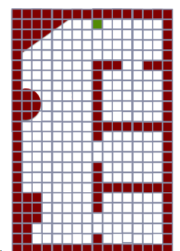
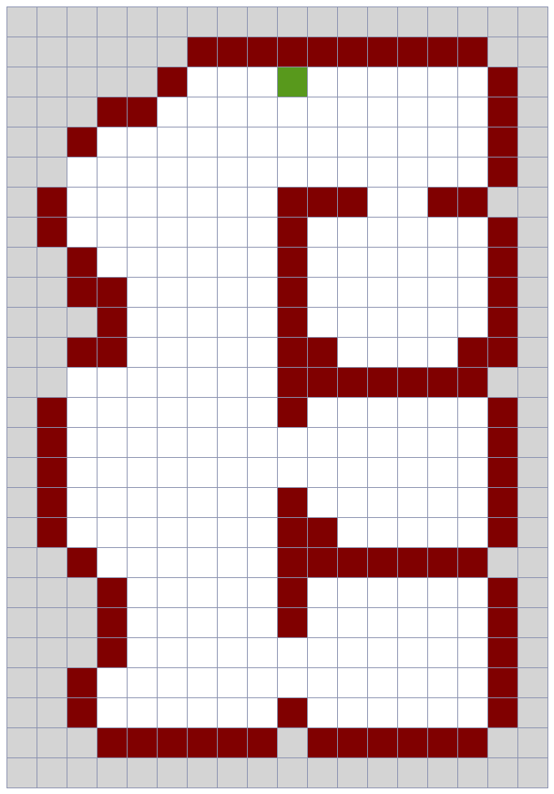

# Kobuki ile Haritalama: Olasılıksal Occupancy Grid + Frontier Keşfi (3×HC-SR04)

## 1. Amaç

Bu örnek, ders notundaki ([lecture-mapping.pdf](lecture-mapping.pdf)) **"A Probabilistic OG Mapping Algorithm"** algoritmasını Kobuki üzerinde uygular. Robot, bilinmeyen bir ortamı kendi başına dolaşır ve haritasını çıkarır. Frontier kalmayınca başlangıç noktasına döner, haritayı PNG ve metin olarak kaydeder.

Donanım 08 (Tangent Bug) ile **aynıdır**: Arduino'ya bağlı sol-ön (+60°), ön ve sağ-ön (−60°) üç HC-SR04. Arduino sketch'i de aynıdır.

| Dosya | Görev |
|---|---|
| [`OccupancyGrid.h`](../01_Sample/KobukiNativeVS/include/OccupancyGrid.h) | Donanımdan bağımsız harita çekirdeği: olasılık ızgarası, sensör modeli, Bayes güncellemesi, büyük hücreli "grid map". |
| [`FrontierExplorer.h`](../01_Sample/KobukiNativeVS/include/FrontierExplorer.h) | Donanımdan bağımsız keşif: frontier bulma, Dijkstra yol planlama, sürüş, etrafa bakma, eve dönüş. |
| [`src/RobotIO.h`](src/RobotIO.h) | Gerçek robot (Kobuki + Arduino) ve **ödev görselindeki planın** dahili simülatörü (`--sim`). |
| [`src/MapView.h`](src/MapView.h) | Canlı harita penceresi ve PNG kaydı (yalnızca Windows GDI/GDI+, ek kütüphane yok). |
| [`src/main.cpp`](src/main.cpp) | Uygulama: döngü, güvenlik katmanı, elle sürüş modu, kayıt ve özet. |
| [`../08_TangentBugAlgorithm/arduino/sensor/sensor.ino`](../08_TangentBugAlgorithm/arduino/sensor/sensor.ino) | Arduino sketch (08 ile ortak): 3 sensör sırayla, kanal başına son 2 ölçümün küçüğü, `{"l":..,"f":..,"r":..}`. |

## 2. Algoritma (ders notu ↔ kod)

```text
1. Initialize Grid to 0.5                       OccupancyGrid: tüm hücreler P(dolu) = 0.5
2. Update the Grid                              her yeni sensör paketinde (10 Hz), o anki pozla:
   - current position = high probability empty    RangeMapper: robot gövdesinin diski -> P = 0.05
   - sensor model + Bayes rule                     integrateRange(): bölge 1 / bölge 2, Bayes
3. Pick a Next Move                             FrontierExplorer:
   - threshold: empty / occupied / unknown         P > 0.7 dolu, P < 0.3 boş, arası bilinmiyor
   - identify frontier nodes, pick one              bilinmeyene komşu, ulaşılabilir boş hücreler; en ucuzu
   - plan a path, go there                          Dijkstra (boş hücreler üzerinde), takip
4. Loop until no frontier nodes are left        frontier kalmadı -> başlangıca dön, kaydet
```

### 2.1 Sensör modeli

Ders notundaki derinlik sensörü modeli, bir okuma `r` için sensör konisini üç bölgeye ayırır:

| Bölge | Koşul | Güncelleme |
|---|---|---|
| 1 | hücre mesafesi `< r` | muhtemelen **boş** |
| 2 | hücre mesafesi `≈ r` | muhtemelen **dolu** |
| 3 | hücre mesafesi `> r` | engelin arkasında, **güncellenmez** |

Bir okumaya bir hücre için ne kadar güvenileceği, dersteki doğruluk modeliyle belirlenir:

\[ c = \frac{1}{2}\left[\frac{R - r}{R} + \frac{B - a}{B}\right] \]

Burada `R` = 2.0 m (güvenilir menzil), `B` = 13° (koni yarı açısı), `r` hücrenin uzaklığı, `a` hücrenin koni ekseninden açısıdır. Sensöre ve eksene yakın hücreler güvenilirdir; uzak ve kenardaki hücreler değildir. `c`, Bayes kuralına giren olabilirliğe dönüştürülür:

\[ P(s\mid O) = 0.5 \pm 0.5 \cdot k \cdot c, \qquad P(s\mid E) = 1 - P(s\mid O) \]

Bölge 2 için `+`, bölge 1 için `−` kullanılır. Kazançlar `k_dolu` = 0.5, `k_boş` = 0.6'dır. Hiç güvenilmeyen bir hücre (`c` = 0) 0.5 alır, yani **bilgi taşımaz**. Ardından her hücre dersteki Bayes güncellemesiyle işlenir:

\[ P(O\mid s_n) = \frac{P(s_n\mid O)\,P(O\mid s_{n-1})}{P(s_n\mid O)\,P(O\mid s_{n-1}) + P(s_n\mid E)\,P(E\mid s_{n-1})} \]

Olasılıklar [0.02, 0.98] aralığında tutulur; böylece bir hücre her zaman fikir değiştirebilir (örneğin önünden geçen bir insan).

### 2.2 Dersin açık bıraktığı, HC-SR04 için gereken kararlar

| Konu | Karar | Neden |
|---|---|---|
| Yankı **yayın neresinden** geldi? | Bölge 2'deki her hücre, önceden dolu olma olasılığı (odds) ile orantılı pay alır. Zaten dolu olduğuna inanılan hücre yankıyı "açıklar". | Sonar en yakın yankıyı verir, ama yankının konide nereden geldiği belli değildir. Bu yapılmazsa her duvarın önünde hayalet bir katman büyür. |
| Bölge 1'in genişliği | Yalnız eksenin ±8°'si "boş" işaretlenir (koni ±13°). | Koninin kenarındaki bir yüzey bazen yankı vermez; geniş bir "boş" koni duvarları siler. |
| Yankı yok (`-1`) | Yalnız ilk 1.0 m "boş" sayılır. | Sığ açıyla görülen düz bir duvar da yankı vermez. |
| Bölge 2'nin kalınlığı | Yüzeyin 10 cm arkasına kadar dolu. | Engel yüzeyin arkasında katıdır; ince bir çizgi gürültüyle kopar. |
| Bağımsız ölçüm varsayımı | Okumalar yalnız robot ≥ 2 cm gittiğinde ya da ≥ 1.5° döndüğünde işlenir. | Bayes ölçümleri bağımsız sayar; duran robotun saniyede 10 aynı okuması bağımsız değildir ve haritayı sahte bir kesinliğe iter. |
| Tampon | Çarpılan nokta (tamponun tarafına göre) "dolu" yazılır. | Sonarın göremediği alçak veya ince engeller de haritaya girer. |
| Sensör ofseti | Her ışın, robot merkezinin 11 cm önündeki sensörden çıkar. | 08 ile aynı montaj. |
| Yuvarlama | Sketch mesafeyi tam cm'ye aşağı yuvarlar; uygulama +0.5 cm ekler. | Ortalama 0.5 cm'lik kısa ölçümü düzeltir. |

### 2.3 İki harita

- **Occupancy grid (sol panel):** 5 cm'lik hücrelerde P(dolu). Beyaz = boş, gri = bilinmiyor, koyu kırmızı = dolu. Keşif ve yol planlama bunun üzerinde çalışır.
- **Grid map (sağ panel):** Varsayılan 0.5 m'lik büyük hücreler (`--grid` ile değişir), ödev görselindeki gibi çizilir. Kural sırası:
  1. Küçük hücrelerinin ≥ %60'ı boşsa **boş**.
  2. Değilse, hücre ve 6 cm'lik çevresinde ≥ 3 küçük dolu hücre varsa **dolu**.
  3. Değilse **bilinmiyor**.

  "Önce boş" kuralı önemlidir. Duvar yüzeyleri çoğu zaman tam büyük hücre sınırındadır ve sonar yüzeyin birkaç cm *önüne* de dolu yazar. Kural sırası ters olsaydı duvarın önündeki serbest hücre de duvar görünürdü; ilk denemede 21 serbest hücre böyle hatalıydı, bu kuralla 4'e indi.

### 2.4 Keşif (frontier) ve hareket

- **Frontier:** Bilinmeyen bir hücreye komşu, robotun ulaşabildiği boş hücrelerdir. Bağlantılı olanlar gruplanır ve 30 cm'den küçük parçalar atlanır. Robot, ulaşması en ucuz grubun ortasına gider. Seçilmiş hedef, başka bir hedef belirgin şekilde (×1.5) ucuz olmadıkça değiştirilmez; bu, iki hedef arasında gidip gelmeyi önler.
- **Yol planlama:** Boş hücreler üzerinde 8 komşulu Dijkstra kullanılır.
  - Dolu bir hücreye `yarıçap + 6 cm` (0.24 m) içindeki hücrelere girilmez.
  - 0.45 m'ye kadar olan hücrelere ek maliyet verilir; böylece yol boş alanın ortasından geçer.
  - Köşe kesme yoktur.
  - Robotun hemen çevresindeki (0.3 m) yasak hücreler istisnadır; robot içinde bulunduğu yasak bölgeden çıkabilsin diye.
- **Takip:** Rota 30 cm ileriden bir nokta hedeflenerek ("carrot") yay şeklinde sürülür. Yön hatası 60°'yi aşarsa robot yerinde döner. Harita büyüdükçe rota her 1.5 s'de yeniden planlanır.
- **Etrafa bakma:** Üç ışın yalnız öne baktığı için robot başlangıçta ve her frontier'a vardığında yerinde bir tam tur döner. Aynı noktada ikinci tur atmaz; orada çözülemeyen frontier kara listeye alınır.
- **Refleks:** Planlayıcının altında, ön ışın merkezden 0.38 m'den yakın bir şey görürse robot ileri gitmez. 3 s böyle kalırsa ya da 8 s hiç ilerleyemezse hedef bırakılır: robot 12 cm geri çekilir ve yeniden planlar. Bu en fazla 12 kez olur, sonra `Fault(Stuck)`.
- **Bitiş:** Frontier kalmayınca robot başlangıca döner, ilk yönüne çevrilir ve durum `DONE` olur.

## 3. Durumlar

| Durum | Davranış |
|---|---|
| `INIT` | Başlangıç pozu kaydedilir. |
| `SCAN` | Yerinde bir tam tur (0.5 rad/s); ışınlar her yönü tarar. |
| `PLAN` | Eşikleme, frontier, Dijkstra. Hedef varsa `DRIVE`, yoksa eve dönüş ya da `ALIGN`. |
| `DRIVE` | Rotayı takip eder ve yeniden planlar. Frontier'a varınca `SCAN`, eve varınca `ALIGN`. |
| `BACK_OFF` | Tampon ya da takılma sonrası 12 cm geri, sonra `PLAN`. |
| `ALIGN` | Başlangıçtaki yöne döner. |
| `DONE` / `FAULT` | Sıfır hız. `FAULT` nedeni süre sınırı (`TimeLimit`) ya da çok sık takılmadır (`Stuck`). |

Uçurum sensörü, 1.5 s sensör kesintisi, `Q`, Ctrl+C ve pencereyi kapatmak **planlayıcıdan bağımsız** olarak robotu durdurur. Her durumda o ana kadarki harita kaydedilir.

## 4. Simülatör: ödev görselindeki plan

`--sim`, görseldeki planı birebir modeller:

- 16 × 24 hücre, hücre başına 0.5 m (8 × 12 m).
- Sol üstteki çapraz duvar ve sol duvardaki yuvarlak engel, hücrelere bağlı değil, gerçek geometrileriyle modellenir.
- Robot yeşil hücreden, odanın içine bakarak başlar.
- Ekran iki çeyrek tur döndürülerek gösterilir, böylece harita görselle aynı yönde görünür (`R` tuşu çevirir).

Sensörler Arduino'yu taklit eder:

- 10 Hz paket hızı.
- Her ışın ±10°'lik konideki en yakın yankıyı tam cm olarak verir.
- Son 2 ölçümün küçüğü raporlanır.
- 4 m'den ötesi yankı vermez.
- `--noise` ile ±1 cm gürültü ve %3 kaçan yankı eklenir.

Duvarlar katıdır: robot çarparsa ilerleyemez ve tampon basılır.

### Doğrulama sonuçları (`Mapping.exe --sim --fast --no-gui`)

| | Gürültüsüz | `--noise` |
|---|---|---|
| Sonuç | Keşif tamam, başlangıca döndü | Keşif tamam, başlangıca döndü |
| Simülasyon süresi / yol | 461 s / 63.3 m | 310 s / 42.3 m |
| Etrafa bakma turu / bırakılan hedef / tampon | 6 / 0 / 0 | 3 / 0 / 0 |
| 5 cm dolu hücrelerin gerçek yüzeye uzaklığı | %51 duvar içinde, %40 ≤ 5 cm önünde, %7 5–10 cm, %3 10–20 cm | %46 / %40 / %9 / %4 |
| Grid map, serbest hücreler (252) | **248 boş**, 4 yanlış dolu | 244 boş, 8 yanlış dolu |
| Grid map, duvar hücreleri (122) | **86 dolu**, 36 bilinmiyor, 0 yanlış boş | 88 dolu, 34 bilinmiyor |

Ek notlar:

- "Bilinmiyor" kalan duvar hücreleri içeriden görülemeyen hücrelerdir: yuvarlak engelin ve çapraz duvarın arkası, kalın duvar bloklarının iç kısmı ve köşeler. Sonar duvarın yalnız yüzeyini görür.
- Yanlış dolu hücreler yuvarlak engelin ve çapraz duvarın kestiği hücrelerin komşularıdır.
- Simülasyonda sensör modelinin menzili de denendi. `R` = 2.5 m ve 3.0 m keşfi kısalttı (316 s / 293 s) ama yanlış dolu hücreleri 4'ten 8'e çıkardı. Doğruluk için 2.0 m seçildi.

Program simülasyonda bu karşılaştırmayı her koşunun sonunda kendisi yazdırır.

| Ödev görseli | Simülasyonda çıkarılan grid map |
|---|---|
|  |  |

Tam resim (occupancy grid + grid map): [docs/sim_result.png](docs/sim_result.png). Metin hali: [docs/sim_result_grid.txt](docs/sim_result_grid.txt).

## 5. Çıktılar

Varsayılan klasör [`output/`](output/) (git'e eklenmez); `--out` ile değiştirilebilir:

| Dosya | İçerik |
|---|---|
| `map_<tarih>.png` | Ekrandaki resim: occupancy grid + grid map + lejant. |
| `map_<tarih>_grid.png` | Yalnız grid map, ödev görseli biçiminde. |
| `map_<tarih>_grid.txt` | Grid map, 0/1 metin haritası olarak: `0` boş, `1` dolu **ya da bilinmiyor** (görülmemiş yer güvenli sayılmaz); üstte `cell`, `start`, `heading` satırları. Biçim 10_AStarPathPlanning ile aynıdır, dosya doğrudan A*'a verilebilir: `AStar.exe map_<tarih>_grid.txt --goal c,r`. |

## 6. Bilinen kısıtlar ve saha testi

- **Odometri kayması:** Harita odometriye dayanır (yön jiroskoptan, mesafe enkoderden), lokalizasyon düzeltmesi (EKF/SLAM) yoktur. Uzun keşiflerde duvarlar kayabilir ve çift görünebilir. Ders notunun "Motion uncertainty" kısmına bakın.
- **Gerçek sonar simülasyondan kötüdür:** Sığ açılı düz yüzeyler (cam, parlak duvar) yankı vermeyebilir; yumuşak yüzeyler yutabilir; köşeler çoklu yansıma yapabilir. Model bunlara karşı temkinlidir (dar "boş" koni, yankısızda kısa temizleme), ama tamamen engelleyemez.
- **Işınlar arası kör açılar:** Etrafa bakma turları bunları kapatır. Sürüş sırasında masa ve sandalye ayağı gibi ince engeller görülmeyebilir; tampon bunları haritaya yazar.
- **Açık kapılar:** Robot dışarıdaki her alanı da keşfetmeye çalışır. Gerçek robotta başlangıçtan 8 m ötesindeki frontier'lar yok sayılır (`--radius`). Toplam süre 30 dakikayla sınırlıdır (`--time`).
- **Dar geçitler:** Dolu hücreye 0.24 m'den yakın merkezler yasak olduğundan ≲ 0.5 m'lik geçitler kullanılmaz.

Önerilen saha sırası:

1. `.\run.ps1 9 -Sim` ile simülatörde izleyin.
2. `-Manual` ile robotu bir duvar boyunca elle sürüp haritayı karşılaştırın.
3. Küçük, kapalı bir alanda (2×3 m kutular) otonom çalıştırın.
4. Daha büyük bir odada otonom çalıştırın.
