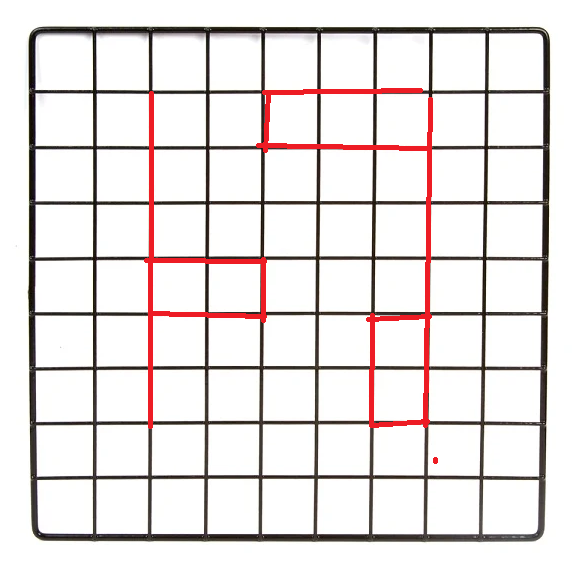
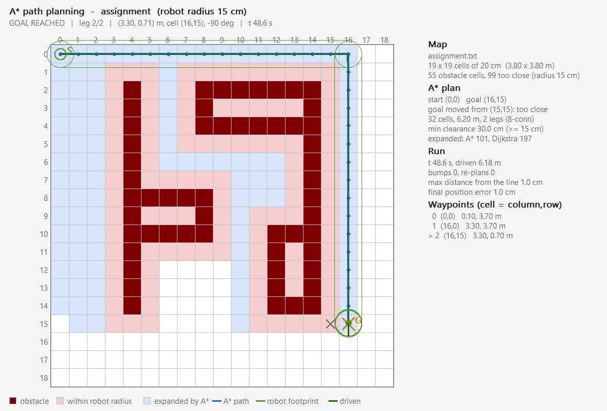
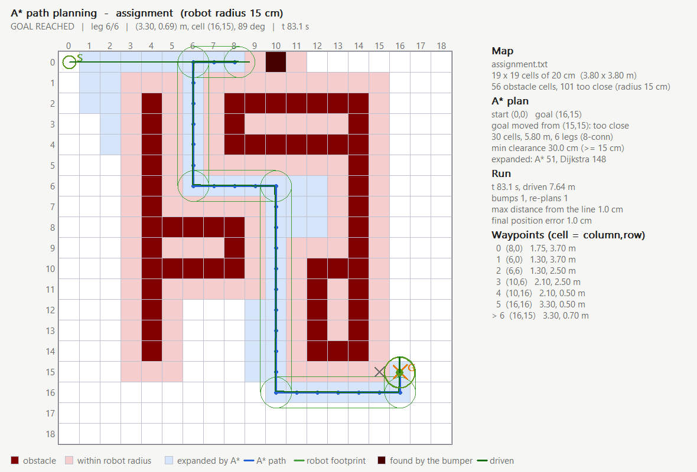
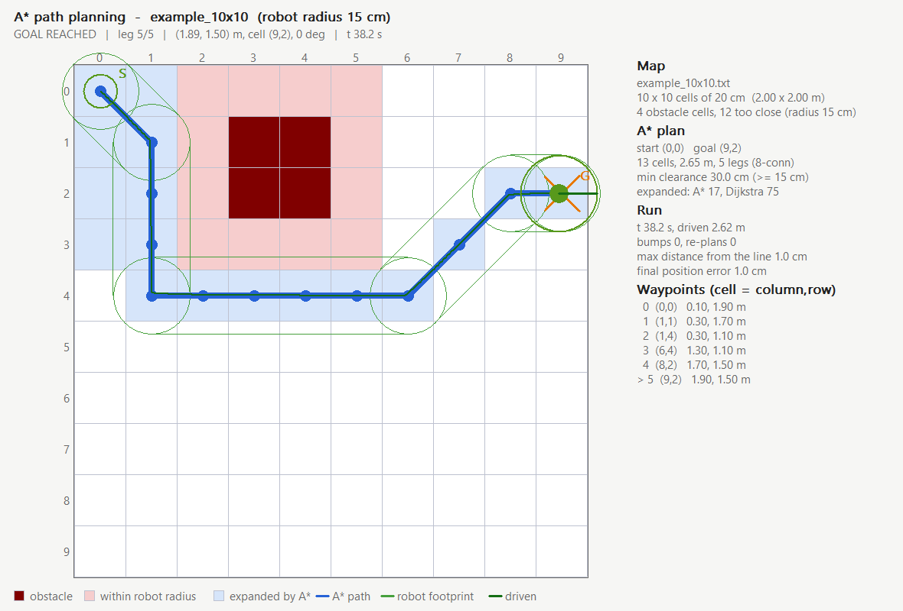
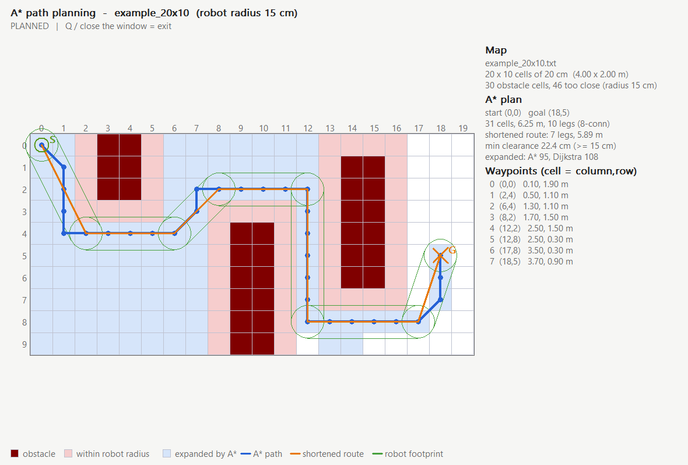

# Örnek 10: A* ile yol planlama (Kobuki)

Robot, bir `.txt` dosyasında 0/1 hücrelerle verilen haritada başlangıçtan hedefe **A\*** ile en kısa yolu bulur. Robotun yarıçapı (15 cm) kadar pay bırakıldığı için engellere değmez. Ardından Kobuki bu yolu sürer. Donanım olmadan da çalışır: yerleşik simülatör aynı haritayı kullanır.

Kullanım: [USER_GUIDE.md](USER_GUIDE.md).

## 1. Harita dosyası

```text
# yorum satırı                 (% ve // da yorum)
cell 0.20                      hücre boyu, metre (varsayılan 0.20)
start 0 0                      başlangıç hücresi: sütun satır
goal  9 2                      hedef hücresi:     sütun satır
heading 0                      robotun ilk yönü, derece (0 = sağa, 90 = yukarı)
0 0 0 0 0 0 0 0 0 0            0 = boş, 1 = engel
0 0 0 1 1 0 0 0 0 0            hücreler boşlukla, virgülle ya da bitişik yazılabilir
0 0 0 1 1 0 0 0 0 0
...
```

- **Koordinat (sütun, satır):** sütun soldan, satır **üstten** sayılır; dosyanın ilk ızgara satırı 0. satırdır. `(18,5)` = 18. sütun, 5. satır.
- `start` / `goal` yerine ızgarada `S` / `G` harfi de kullanılabilir.
- Komut satırındaki `--start`, `--goal`, `--heading`, `--cell` dosyadaki değerleri ezer.
- Hatalı dosyada program satır numarasıyla birlikte hatayı söyler (ör. `line 4: this row has 3 cells, the first row has 4`).

Metre cinsinden harita çerçevesinde orijin haritanın **sol-alt köşesi**, +x sağa, +y yukarı doğrudur. (c, r) hücresinin merkezi `((c+0.5)·cell, (satır_sayısı − r − 0.5)·cell)` noktasıdır.

### Hazır haritalar ([maps/](maps/))

| Dosya | Boyut | Ne gösterir |
|---|---|---|
| `assignment.txt` | 19×19 (3,8 × 3,8 m) | Ödev görselindeki plan (varsayılan harita) |
| `example_10x10.txt` | 10×10 (2 × 2 m) | Hocanın örneği: 40 cm'lik kutu, robot (0,0) |
| `example_20x10.txt` | 20×10 (4 × 2 m) | Hocanın (0,0) → (18,5) örneği, üç engelle |

### Ödev görselinin dönüştürülmesi



Görseldeki kırmızı duvarlar karelerin içinde değil, ızgara **çizgilerinin üzerindedir**. 0/1 hücre haritasında bir çizgi ancak bir hücre sırasıyla gösterilebilir. Bu yüzden her çizgi bir hücre, her karenin içi bir hücre sayılarak 9 kare **2·9+1 = 19** hücreye açıldı. Görseldeki k. çizgi hücre 2k'ye denk gelir; örneğin sol duvar 2. çizgide, yani 4. sütundadır.

Kırmızı nokta (sağ duvarın alt ucunun hemen sağ-altı) **(15,15)** hücresine düşer. Bu hücrenin merkezi duvar köşesine yalnızca **14,1 cm** uzaktadır, yani 15 cm'lik paydan yakındır. Program bunu bildirir ve hedefi başlangıçtan ulaşılabilen en yakın güvenli hücreye, **(16,15)**'e kaydırır. `--strict` verilirse hedefi kaydırmaz, durur.

## 2. Robot yarıçapı kadar pay: konfigürasyon uzayı

Robot bir nokta değil, 15 cm yarıçaplı bir dairedir. Klasik çözüm engelleri robot yarıçapı kadar **şişirmek** ve robotu nokta saymaktır:

> Bir boş hücrenin **merkezi**, herhangi bir engel hücresinin (kare) en yakın noktasına 15 cm'den yakınsa o hücre "şişirilmiş" sayılır. Robotun merkezi oraya giremez.

Uzaklık hücre merkezleri arasında değil, merkezden engel **karesinin kenarına** ölçülür. 20 cm'lik hücrelerde bu şöyle sonuç verir:

| Engelden konum | Merkez → engel kenarı | 15 cm pay |
|---|---|---|
| Hemen yanı | 10 cm | yasak |
| Çaprazı | 14,1 cm | yasak |
| 2 hücre ötesi | 30 cm | serbest |
| (2,1) ötesi | 31,6 cm | serbest |

Yani 15 cm'lik pay, engelin çevresindeki 1 hücrelik halkayı (köşeler dahil) kapatır. Konsolda bunlar `+`, resimde açık kırmızı gösterilir. Bunun önemli bir sonucu var: iki duvar arasındaki **tek karelik koridorlar** (görselde 40 cm, aradaki boşluk 20 cm) 30 cm çaplı robota kapalıdır; A* bunlardan geçmez.

- `--radius 0.18`: Kobuki'nin gerçek yarıçapı yaklaşık 17,5 cm'dir. 20 cm hücrede sonuç değişmez, çünkü 30 cm'ye kadar her yarıçap aynı halkayı verir.
- `--margin 0.05`: odometri hatasına karşı ek güvenlik payı.
- Harita kenarı varsayılan olarak duvar **sayılmaz**, çünkü hocanın örneğinde robot (0,0) köşe hücresinde duruyor ve merkezi kenara 10 cm uzakta. Gerçek alan duvarla çevriliyse `--walled` verin. O zaman kenar da şişirilir ve robot kenardan 15 cm uzak durur.

## 3. A*

Kod: [AStarPlanner.h](../01_Sample/KobukiNativeVS/include/AStarPlanner.h) (`astar::search`).

- **Düğüm:** hücre. **Komşular:** 8 yön (`--4` ile yalnızca 4 düz yön).
- **g:** başlangıçtan gelinen yol uzunluğu. Düz adım 1 hücre, çapraz adım √2 hücre.
- **h:** hedefe tahmini mesafe. 8-komşulukta *octile* `max(dx,dy) + (√2−1)·min(dx,dy)`, 4-komşulukta Manhattan. İkisi de kabul edilebilir ve tutarlı olduğu için A* en kısa yolu bulur ve her hücreyi bir kez kapatır.
- **f = g + h** en küçük olan açık hücre genişletilir. Eşit f'de g'si büyük olan, yani hedefe yakın olan önce gelir; bu, A*'ın eşit f'li düzlükleri boşuna taramasını önler.
- **Köşe kesme yok:** çapraz adımda yanındaki iki hücre de serbest olmalı.
- Açık liste `priority_queue` ile tutulur. Daha kısa yol bulununca yeni kayıt eklenir, eskisi çekildiğinde atlanır (lazy deletion).
- Başlangıç şişirilmiş bölgedeyse (örneğin çarpmadan sonra) robot zaten oradadır. Bu durumda A* oradan **çıkmasına** izin verir; şişirilmiş hücreye geri girmek yasaktır.
- Karşılaştırma için aynı arama h = 0 ile (Dijkstra) de çalıştırılır ve genişletilen hücre sayıları yazılır.

Yol, yön değiştirdiği **köşe hücrelerine** indirgenir; robot iki köşe arasını düz gider. `--smooth` verilirse yol "görüş hattı" ile kısaltılır: her noktadan, arada en az r + 5 cm boşluk kalarak düz gidilebilen en uzak sonraki noktaya atlanır. Böylece bacak sayısı azalır, açılar serbestleşir.

Her planın sonunda rota 1 cm aralıkla örneklenir ve robot merkezinin engellere en yakın mesafesi (`min clearance`) hesaplanıp yazılır. Bu değer yarıçaptan küçük olamaz.

## 4. Sürüş

Kod: [src/PathFollower.h](src/PathFollower.h).

1. **Dön:** robot bacağın sonuna dönük olana kadar yerinde döner (tolerans 3°, en düşük açısal hız 0,15 rad/s).
2. **Git:** düz bacakta ilerler. Yön ayar noktası, bacak yönüne yanal hata kadar düzeltme eklenerek bulunur (`atan(e / 0,20 m)`), böylece robot çizgiye geri döner. Hız 0,15 m/s'dir, sona yaklaştıkça düşer. Noktaya 1 cm kala bacak biter.

Gerçek robotta konum Kobuki'nin jiroskopundan (yön) ve tekerlek enkoderlerinden (mesafe) gelir; bunlar haritadaki başlangıç pozuna göre harita çerçevesine çevrilir.

**Tampon:** haritada olmayan bir engele çarpınca robot durur ve değdiği hücreyi haritaya engel olarak ekler. Sonra 10 cm geri çekilir ve bulunduğu hücreden **yeniden A\*** çalıştırır. En fazla 10 kez yeniden planlar. Simülatörde `--block c,r` bu durumu dener: hücre gerçekte vardır ama planlayıcının haritasında yoktur.

**Güvenlik:** uçurum sensörü, `Q`, Ctrl+C ya da pencereyi kapatmak robotu durdurur. Ayrıca planlanan sürenin yaklaşık 20 katında süre sınırı vardır.

## 5. Sonuçlar (simülatör, robot yarıçapı 15 cm)

| Harita | A* yolu | Genişletilen hücre (A* / Dijkstra) | Sürüş | Hedef hatası |
|---|---|---|---|---|
| assignment (0,0) → (16,15)\* | 32 hücre, 6,20 m, 2 bacak | 101 / 197 | 48,6 s, çarpma yok | 1,0 cm |
| assignment + `--block 10,0` | çarpma → yeniden plan: 30 hücre, 5,80 m | 101 / 197 | 83,1 s, 1 çarpma, 1 yeniden plan | 1,0 cm |
| example_10x10 (0,0) → (9,2) | 13 hücre, 2,65 m, 5 bacak | 17 / 75 | 38,2 s, çarpma yok | 1,0 cm |
| example_20x10 (0,0) → (18,5) | 31 hücre, 6,25 m, 10 bacak | 95 / 108 | 84,8 s, çarpma yok | 1,0 cm |
| example_20x10 `--smooth` | 7 bacak, 5,89 m | 95 / 108 | – | – |

\* (15,15) istendi, güvenli olmadığı için (16,15) kullanıldı.

- `--smooth` dışındaki tüm yollarda robot merkezi engellere en az **30 cm** uzak kalır; gereken 15 cm'dir. `--smooth` ile bu 22,4 cm'ye iner, yine de gerekenin üstündedir.
- Planlama süresi 0,1 ms'nin altındadır.
- Simülatörde tüm haritalar uyarısız derlendi ve hedefe ulaşıldı. Gerçek robotta henüz denenmedi.

| Ödev haritası | Haritada olmayan engel ile |
|---|---|
|  |  |

| example_10x10 | example_20x10 `--smooth` |
|---|---|
|  |  |

Resimlerde:
- koyu kırmızı = engel;
- açık kırmızı = robot merkezinin giremeyeceği hücreler;
- açık mavi = A*'ın genişlettiği hücreler;
- mavi çizgi = A* yolu;
- yeşil çerçeve = robotun gövdesinin süpürdüğü alan (yolun iki yanında yarıçap kadar);
- koyu yeşil çizgi = robotun gerçekte gittiği yol.

Metin çıktısı örneği: [docs/assignment_plan.txt](docs/assignment_plan.txt).

## 6. Dosyalar

| Dosya | İçerik |
|---|---|
| [01_Sample/.../AStarPlanner.h](../01_Sample/KobukiNativeVS/include/AStarPlanner.h) | Harita okuma, şişirme, A*, yol kısaltma, açıklık kontrolü (donanımdan bağımsız) |
| [01_Sample/.../GdiCanvas.h](../01_Sample/KobukiNativeVS/include/GdiCanvas.h) | Çizim tuvali, pencere, PNG (09 ile ortak) |
| [src/main.cpp](src/main.cpp) | Argümanlar, doğrulama, plan, sürüş döngüsü, kayıt |
| [src/Robot.h](src/Robot.h) | Gerçek Kobuki ve simülatör |
| [src/PathFollower.h](src/PathFollower.h) | Dön-git yol takipçisi |
| [src/PlanView.h](src/PlanView.h) | Harita resmi |
| [maps/](maps/) | Örnek haritalar |
